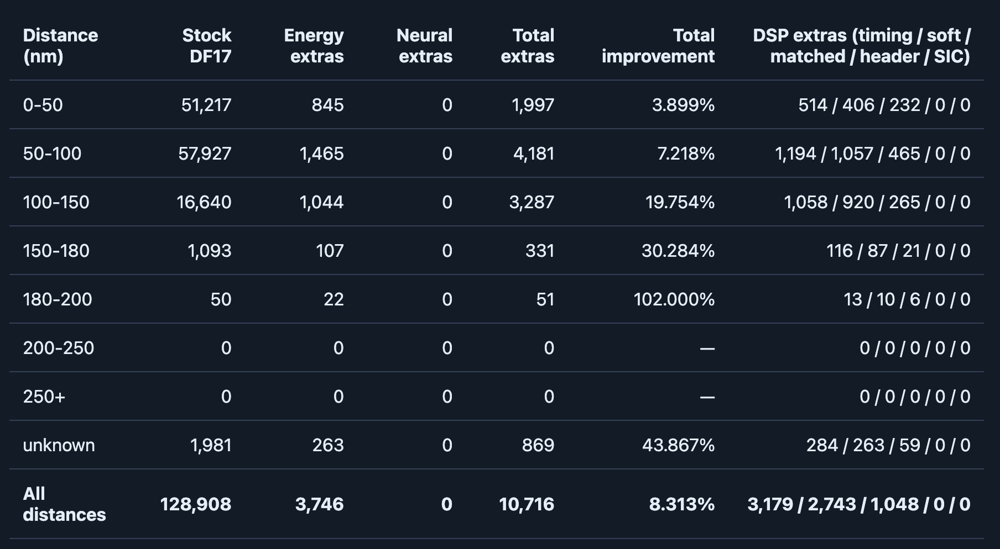

# deadsb dsp · readsb-dsp

An integrated, experimental ADS-B receiver distribution: **readsb + energy/DSP +
neural rescue + dashboard + offline benchmarks**, with adaptive rescue CPU
budgeting. This is an independent GPL-3.0-or-later project, not an endorsed
upstream readsb release.

The repository is **[mitgor/readsb-dsp](https://github.com/mitgor/readsb-dsp)**.
The project/product name is **deadsb dsp**. The original DSP-only patch package,
release history and reproducible preparation helper are retained; see
[the legacy guide](docs/LEGACY_PACKAGE.md).

## What's included

| Component | Location | Purpose |
|---|---|---|
| Complete pinned readsb fork | `readsb/` | Primary decoder, optional native DSP-only rescue and nonblocking I/Q tap |
| Native shared frontend and workers | `src/rescue/` | Energy, timing, weak-bit repair, matched/coherent filtering, optional neural cascade |
| CPU governor | `src/deadsb/governor.py` | Total system utilization feedback; reduce optional work under load |
| Loopback dashboard | `deadsb dashboard` | CPU target, admission profile, per-method reception/CPU and distance statistics |
| Offline benchmark | `deadsb benchmark` | Reproducible UC8 replay, packet digest and CPU cost, no network output |
| Native stock/DSP controls | `readsb/tests/dsp-rescue/` | Stock preservation, boundaries, noise and sanitizer checks |

Readsb is based on 3.16.18 / upstream commit `9460652`, plus our prepared native
integration and nonblocking tap. [Provenance](docs/INTEGRATION_PROVENANCE.json)
records exact source commits and imported runtime/model hashes. No private RF,
receiver coordinates, feeder sharing keys or installed configuration are bundled.

## Filters, decoders and the science behind them

ADS-B DF17 uses pulse-position modulation: an early half-microsecond pulse
represents a one, and a late pulse represents a zero within each one-microsecond
bit. An eight-microsecond preamble precedes 112 data/parity bits. Our rescue
frontend represents that 120-microsecond window as 480 complex samples at
4 MS/s. The methods below offer different ways to detect the preamble, estimate
pulse timing and decide those same received bits; they do not create aircraft
messages from tracks or external flight data. See the [signal definitions](src/rescue/dsp.py)
and [stock demodulator](readsb/demod_2400.c).

### Shared frontend and pulse timing

The RTL-SDR input is complex I/Q at 2.4 MS/s. A Kaiser-windowed low-pass FIR and
5:3 polyphase resampling produce the 4 MS/s working grid. This makes the two
halves of a bit easier to compare and allows several decoders to reuse the same
samples, power envelope and preamble scores. Resampling interpolates existing
band-limited information: it does **not** increase the receiver's RF bandwidth
or recover information lost to clipping. The reference construction follows
[SciPy's polyphase FIR resampling](https://docs.scipy.org/doc/scipy/reference/generated/scipy.signal.resample_poly.html).

The preamble detector correlates received power with the known pulse pattern,
normalizes the score and selects bounded candidate windows. Overlapping FIR and
packet context protect block boundaries. Absolute sample positions preserve
resampler phase and Beast timestamps; a packet crossing a worker boundary must
not become a duplicate or a newly invented transmission. The [shared ring](src/rescue/ring_transport.py)
and [cached FIR](src/rescue/fir_cached.py) reuse frontend work across DSP and
coherent workers.

### What each method does

“On” below means enabled by the supplied full-bundle configuration. CPU admission
may reduce its budget or suspend it. Optional methods require explicit operator
configuration and appropriate validation before feeding.

| Method | Scientific idea and implementation | Supplied configuration |
|---|---|---|
| **Energy slicer** | Compare integrated power in the early and late halves of each bit. Normalized/clipped energy reduces sensitivity to absolute gain and extreme peaks. A cheap alternate slicing path can recover packets missed by stock candidate selection or bit decisions. [Code](src/rescue/dsp.py) | On |
| **Eight-phase rolling CRC** | Native readsb DSP option adapted from Stream1090's magnitude interpolation and sliding Manchester/CRC search. It does not require a preamble peak, but currently accepts only clean DF17 and uses the established stock-identity guard. [Code](readsb/dsp_stream_phase.c), [port notes](docs/STREAM_PHASE.md) | Off |
| **Fractional timing** | Retry a bounded set of nearby sample alignments using windowed-sinc interpolation. This addresses pulses arriving between sample instants; it adds timing hypotheses, not RF bandwidth. [Code](src/rescue/classical.py) | On |
| **Soft-bit repair** | Use decision confidence to select at most six weak payload/parity bits and test unique one/two-bit CRC syndrome solutions. Up to 21 hypotheses are considered; DF/CA/ICAO bits 0–31 remain protected. Native lookup accelerates the same restricted policy rather than searching arbitrary packet variants. [Code](src/rescue/classical.py) | On |
| **Matched filtering** | Estimate carrier offset and a short complex pulse template from the known preamble, then compare early/late complex correlations. Matching a known waveform integrates its energy coherently instead of treating each power sample independently. [Code](src/rescue/classical.py) | On |
| **Coherent decoding** | Estimate carrier rotation and phase from usable received pulses, reject outliers, and form phase-aligned bit decisions. A bounded alternate preamble-pair estimate can retry difficult windows. This uses complex I/Q phase; it does not change ADS-B's pulse-position modulation. [Code](src/rescue/coherent_kernel.c) | On |
| **Neural companion cascade** | A small residual convolutional network learns corrections to the conventional energy decision. Later frozen companions run only on windows unresolved by earlier models; valid original output wins. The current production input is normalized power plus log-power, with preamble context—not raw complex I/Q phase. [Architecture](src/rescue/model.py), [cascade](src/rescue/model_cascade.py) | On |
| **Learned pulse filter** | An eight-sample linear energy discriminant uses class means and shrinkage covariance learned from stock-confirmed bits. Neighboring samples can distinguish distorted early/late pulses. This is a compact learned filter, separate from the convolutional neural cascade. [Code](src/rescue/pulse_discriminant.py) | Off |
| **Pulse-aware sequence detection** | Score neighboring bit hypotheses using a short pulse-response model, accounting for pulse tails and intersymbol interference. It reuses coherent carrier work instead of making every bit decision independently. [Code](src/rescue/research_sequence.py) | Off |
| **Extended acquisition** | Search additional candidates with a longer known preamble/DF pattern, then use the existing carrier/decoder path. It targets missed candidate starts rather than repairing already decoded positions. [Code](src/rescue/research_sequence.py) | Off |
| **Header retry** | A separate, bounded research path relaxes initial header screening. Because it changes an important admission gate, it is not part of the default protected-header repair policy. [Code](src/rescue/classical.py) | Off |
| **Successive interference cancellation (SIC)** | Fit a separately known valid packet's waveform and subtract it from a copy of the I/Q window, then decode the residual. Reject poor fits; subtraction errors can otherwise create misleading structure. This is an overlap experiment, not a universal collision solution. [Code](src/rescue/classical.py) | Off |

For a known waveform in additive white Gaussian noise, matched filtering
maximizes the sampled output signal-to-noise ratio. Actual ADS-B reception also
contains unknown pulse shapes, multipath, clipping and overlapping transmissions,
so that result motivates the method but does not guarantee a field improvement.
[MIT's matched-filter lecture](https://www.ocw.mit.edu/courses/6-011-signals-systems-and-inference-spring-2018/dfe2855f36e44436678bfd3736c937fe_MIT6_011S18lec24.pdf)
explains the assumptions and detection trade-off.

Pulse-tail decision-feedback retries and joint channel estimation are additional
[research modules](src/rescue/pulse_tail_research.py), not default feeder sources.
Their presence in the source tree does not enable them. A phase-aware neural
receiver is also distinct from the magnitude-based models shipped here.

### Acceptance, overlap and CPU cost

A plausible bit sequence is not automatically an accepted extra. The established
full-pipeline guards require a valid DF17 CRC, verified sample-clock alignment,
a recent **stock-established** aircraft address, and no nearby stock/accepted
payload duplicate or same-aircraft timing conflict. Additional packets cannot
establish their own identity. Broad CRC hypotheses remain quarantined. CRC and
address checks reduce false acceptance; they are not independent RF ground truth.
See [comparison guards](src/rescue/shadow.py) and [relay policy](src/rescue/feed.py).

Different methods often recover the **same transmission**. The total improvement
is the deduplicated, accepted union beyond stock, with one method attribution
per extra—not the sum of separate unmerged benchmark runs. Repeated identical
payloads at different valid transmission times can still be separate packets;
packet counts are not counts of unique aircraft. A counterfactual replay with a
method removed is needed to measure that method's unique marginal contribution.

Shared FIR, power, preamble and carrier calculations make per-method CPU costs
partly interdependent. The dashboard reports attributed CPU and CPU milliseconds
per extra; neither is a wattage measurement or proof of optimal efficiency.
The [CPU governor](src/deadsb/governor.py) uses conservative admission profiles
and measured system utilization. Its 60% ceiling is a cooperative control target,
not a guarantee against stock load, unrelated activity or brief spikes.

## Example reception statistics



*User-provided receiver screenshot, 25 October 2026. This is an earlier dashboard
and decoder configuration, not a benchmark of this release or its CPU governor.*

The screenshot records **128,908 stock DF17 transmissions** and **10,716 counted
extras**, or **8.313%** additional transmissions relative to stock. Its recorded
attribution is 3,746 energy + 3,179 timing + 2,743 soft + 1,048 matched; neural,
header and SIC extras are zero in this snapshot. The older table has no separate
coherent column and provides no evidence of a neural gain in that interval.

The displayed percentage is `100 × total extras / stock DF17`. The 180–200 nm
row's 102% is 51 extras against only 50 stock packets: a small denominator, not a
claim of doubled maximum range. The 200–250 and 250+ nm rows contain no packets.
“Unknown” distance stays separate from verified range bins. The screenshot does
not establish independent packet truth, a false-positive rate, a representative
long-term gain, or the performance of methods added after it was taken.

## Build locally

Python 3.11+, a C compiler, make, zstd, zlib and ncurses development headers are
required. RTL-SDR builds also need librtlsdr and libusb development packages.

```sh
git clone https://github.com/mitgor/readsb-dsp.git
cd readsb-dsp
python3 -m venv .venv
.venv/bin/pip install -e .
.venv/bin/deadsb build                 # native libraries + file-only readsb
# .venv/bin/deadsb build --rtlsdr      # helper cleans only its own decoder build first
PYTHONPATH=src .venv/bin/python -m unittest discover -s tests -v
make -C readsb test dsp-rescue-test dsp-rescue-test-sanitize
```

Builds do not install binaries, open the SDR or change receiver services. The
existing receiver keeps running its existing installation. Copying these files
onto a receiver does not enable the new governor.

## 60% CPU target

The supplied policy targets **55% total system CPU over 30 seconds**, with a
**60% ceiling used for stronger shedding**. It samples Linux `/proc/stat`, not
load average. Four cores at 60% mean 2.4 CPU-seconds per wall second, including
stock decoding, feeders and unrelated processes.

| Profile | Rescue admission |
|---|---|
| Full | Operator-configured methods and existing budgets |
| Bounded | Halved neural/coherent candidate budgets; pair, sequence and acquisition retries suspended |
| Cheap | Energy + configured timing/soft/matched; neural/coherent and research work suspended |
| Energy | Additional energy slicing only |
| Stock-only | No rescue decoding; primary readsb continues independently |

The governor can only reduce already configured methods. It changes job admission
at RF-second boundaries; it never changes thresholds, CRC/identity guards, model
weights, feeder routing, gain or collection limits. It reduces work every five
seconds under pressure and restores one profile after 60 seconds of cool,
low-CPU operation. Stale/invalid telemetry, severe backlog or heat suppress rescue.
The shared frontend producer/consumer lifecycle remains bounded at every level.

**This is a cooperative target, not a guaranteed system-wide cap.** Stock and
unrelated work are never throttled. Short spikes and a stock-only baseline above
60% can exceed the target. Shedding work can lose rescue extras; it does not
replace or discard stock output. Profile ordering is a conservative policy, not
proof of the most efficient bundle. Independent ablation benchmarks are required
before claiming optimal recovery per CPU second.

## Full receiver mode

Use one stock-first readsb process with the I/Q tap and separate rescue workers.
Readsb's optional in-process `--dsp-rescue` must remain **off** in this mode to
avoid doing the same DSP twice. The native-only mode is an alternative for simpler
receivers; its cooperative microsecond budget is documented separately in
[the native guide](docs/NATIVE_DSP_RESCUE.md).

The tap is inactive unless the readsb process is explicitly started with
`ADSB_RESCUE_SOCKET=/run/deadsb/iq.sock`. Readsb remains the sole SDR owner. Rescue
input and output use separate sockets; no candidate output is automatically sent
to a feeder. A manual deployment profile is in [the integration guide](docs/DEADSB.md).
It deliberately requires the operator's receiver location and established output
routing. Existing stock-only and guarded-union outputs can serve FR24 and ADS-B
Exchange; unverified research branches stay quarantined.

```sh
# After setting up a dedicated runtime and supplying your own receiver location:
deadsb shadow --root "$PWD" --runtime /run/deadsb --archive /var/lib/deadsb \
  --lat YOUR_LAT --lon YOUR_LON --config config/methods.json \
  --worker-config config/workers.json --cpu-budget-config config/cpu-budget.json \
  --no-logging
# Separate terminal; binds only 127.0.0.1, no receiver/service control:
deadsb dashboard --runtime /run/deadsb --budget-config config/cpu-budget.json
```

The new dashboard is `http://127.0.0.1:8912/`. It distinguishes configured methods
from current admission and reports CPU cost per attributed additional packet.
Shared costs and attribution do not establish causal marginal benefit or power.
This interface changes only budget settings; method configuration is explicit in
`config/methods.json` and requires a rescue worker restart to reload.

## Benchmark without touching the receiver

```sh
OPENBLAS_NUM_THREADS=1 OMP_NUM_THREADS=1 deadsb benchmark \
  --iq /path/to/recording.uc8 --output /tmp/deadsb-full.json --profile 0
# A separate, fresh output for an explicitly reduced policy:
deadsb benchmark --iq /path/to/recording.uc8 --output /tmp/deadsb-cheap.json --profile 2
```

UC8 input must be 2.4 MS/s and start at the native resampler's phase-zero origin.
Use sample-index reservations and aligned crops for RF from a continuous receiver.
Reports contain aggregate candidate counts, RF hash, packet digest and CPU cost;
raw candidates are **not** verified additional transmissions. Distance and gains
beyond stock/actual production require synchronized stock, accepted-DSP and
position ledgers. Do not tune against held-out RF or train on unverified outputs.

## Status and limits

This source integration is being validated independently of the working receiver.
The 60% policy has simulation and isolated replay tests; it does not yet have a
sustained live overload/thermal qualification. No automatic deployment, new RF
capture or feeder restart is performed by any build/benchmark command.
Read [validation](validation/DEADSB.md) for the current evidence and limitations.
