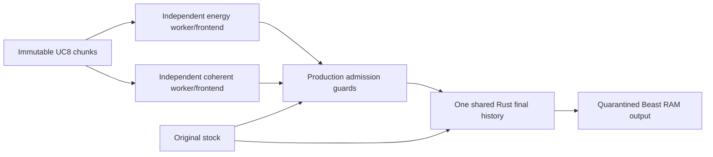

# Independent energy/coherent test and shared Rust deduplicator

User explicitly chose an isolated test. Live methods, stock-only FR24, ADS-B Exchange, receiver, gain and collection are unchanged. Results: `validation/energy-coherent-async-20261030/report.md`; aggregate HTTP report: `http://192.168.2.195/neural-rescue/energy-coherent-async-20261030/report.html`.



`bench.py` uses separate spawned one-worker process pools, bounded pending queues and independent 50 ms dispatch/completion. Coherent never waits for energy's frontend file or future. Shared immutable raw input is the only RF transport shared. Frontend calculations are deliberately duplicated. Coherent admission still needs causal rolling energy/stock alignment evidence; this is not removed to obtain faster output. Other methods, neural inference and broad CRC are disabled only inside this copy. Coherent retains its existing bounded pair retry. The controlled target CPU quota is shared by both processes on core3: independence here means no cross-worker future barrier, not a two-core benchmark.

`admission.py` reuses unchanged production `evaluate` with indexed stock snapshots. Its global cross-method Python cache is removed: one final `RustHistory` handles stock/energy/coherent transmission history. Original CRC, alignment, prior-stock address, conflict, epoch, stock progress and age gates stay. Same-source/per-call admission still checks duplicates against stock; this is a safety policy, not another final shared emitter.

`dedup.rs` is a dependency-free Rust cdylib. Full 14-byte payload and RF timestamp within 120 us identify a transmission. Wall-monotonic expiry is five seconds, with 100000 entries maximum, bucket-indexed lookup, epoch resets, validation/anchor checks and counters. Stock always passes and late stock races are counted. The same payload at a different RF time passes. There is no sleep, aggregation, timestamp rewriting or output sorting. `rust_history.py` serializes ctypes ownership/access; all calls occur before the one final writer. Original valid stock frames are preserved in order and extras are encoded as Beast with original sample timestamps. Captured stock in this fixture is DF17 only; opaque/control-frame behavior is outside this replay.

Build/test locally with project Python:

```
python experiments/energy-coherent-async-20261030/build.py --output /tmp/owned-energy-coherent-build
python experiments/energy-coherent-async-20261030/test_dedup.py /tmp/owned-energy-coherent-build/dedup.so experiments/async-relay-20261030/dedup.py /tmp/owned-energy-coherent-build/parity.json
PYTHONPATH=src python experiments/energy-coherent-async-20261030/test_final.py /tmp/owned-energy-coherent-build/dedup.so
```

For target replay, create a new owned tmpfs stage with copies of current `src`, `models`, worker config, experiment sources and the previous completion-bridge module. Use the checksum-verified reserved eight RF seconds from private `data/raw/completion-bridge-20261030/capture-evidence.tar`; no new RF collection is needed. `protected.py` checks current trial health and exact source/model/config/PID continuity. Use nice19/core3/CPUQuota35%/MemoryMax1G/finite runtime, never production output paths. Stock-only trial must remain healthy on30005. The staged build uses the existing verified standalone1.99.1aarch64 toolchain archives; no compiler is installed on the receiver. Inputs: rustc SHA256 `acdcdfe09ae1f103aa9a2b7f88903a9588bc2e99288af10e6fbf5514e2e49f25`, rust-std SHA256 `e25668477083d6a9ddb87b9beb9c00742225f38233ccb4bfba3afa7a07427f52`.

Baseline-only processing fills any queue-shed jobs after the timed phase, never forwarding those results. This ensures all 320 jobs support the two-method baseline without pretending they were on time. The repeat adds only full-baseline CPU observability and final contract checks. Both repeats and every raw source/model/waveform/output artifact stay private. Complete grouped two-method recovery was167/210recorded full-pipeline extras for this short fixture; timed output was87/167with5estimated under250ms. Do not claim general accuracy/range or production latency from this capped repeated engineering RF.

No live feeder receives experimental data. No automatic activation, collection change, training label creation or model fitting. Preserve checksummed Mac evidence before cleaning only owned target tmpfs files. Commit only this experiment; raw data and models never enter Git.
